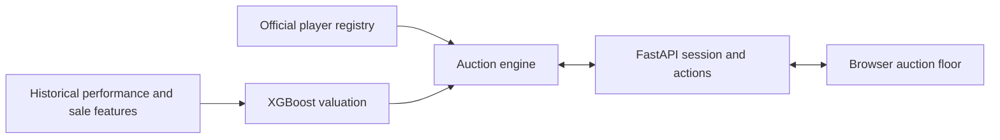

# IPL Auction Room

**Run an IPL franchise from the auction table.**

Pick your team, set your retentions, and raise your paddle against nine AI franchises in a browser recreation of the **2025 IPL mega auction**. Decide when to chase a marquee player, when to let a rival spend, and how much purse to save for the uncapped sets.

[Quick start](#quick-start) · [Auction room features](#auction-room-features) · [Sports ML benchmark](#sports-ml-benchmark) · [Architecture](#architecture) · [Contribute](#contribute)

| Franchises | Player registrations | Auction set groups | Historical training sales | Rolling price MAE |
| :---: | :---: | :---: | :---: | :---: |
| **10** | **574** | **79** | **929** | **₹1.85 Cr** |

The registration counts describe the official November 15 auction pool. The price error comes from a five-season historical backtest. [Official IPL auction list](https://www.iplt20.com/news/article/tata-ipl-2025-player-auction-list-announced)

## Auction room features

| Feature | What you can do |
| --- | --- |
| **Live auction floor** | Bid directly from your franchise's table. See delegates raise paddles, bids arrive one at a time, and the auctioneer call the lot. |
| **Franchise management** | Choose your retentions, track remaining purse and squad slots, and weigh when to use a simplified Right to Match offer. |
| **Player scouting** | Open reserve and model valuations, previous franchise, and available batting, bowling, and experience metrics from the current lot. |
| **Rival squad inspection** | Open any rival table to see its remaining purse, retained and purchased players, and overseas slots. |
| **Set-by-set play** | Reveal each set in an animated pouch, preview its players, or use **Skip player** to finish a lot and move on. |
| **Auction record** | Review live bid history and completed results, including winning franchises, sale prices, and unsold players. |

The AI uses franchise preferences, positional needs, purse, squad limits, and auction progress to decide whether to bid and where to stop. A lot can go unsold while teams still have cash and roster space.

## Quick start

Use Python 3.10 or newer from the repository root.

```bash
python -m pip install -r requirements.txt
python main.py
```

Open [http://127.0.0.1:8000](http://127.0.0.1:8000), choose your franchise, and select **Open bidding** after the first set reveal. The browser resumes your session on refresh while the server is running.

Use `python main.py --port 8001` if port 8000 is occupied, or `python -m src.auction_simulator` for terminal play.

## Sports ML benchmark

The valuation model uses **17 inputs** from career, recent, and peak performance, player role, overseas status, and international experience. XGBoost learns from historical sale prices and returns an estimate in crore. During play, **169 of 574 registrations** have usable model features. For other players, the AI starts from the listed reserve and applies its bidding rules.

### Historical valuation accuracy

The rolling backtest evaluated **527 sales** in the 2018, 2019, 2020, 2021, and 2022 auctions. Each fold used earlier seasons for training. The current model reduced pooled mean absolute error by about **14%** compared with the training-median baseline. The 2025 outcomes are excluded from training.

| Model or experiment | All sales MAE | Sales of ₹8 Cr or more MAE |
| --- | ---: | ---: |
| Training-median baseline | ₹2.16 Cr | — |
| **Current XGBoost model** | **₹1.85 Cr** | **₹7.53 Cr** |
| 350 trees at depth 4 | ₹1.85 Cr | ₹7.46 Cr |
| Current settings with 3× weight on sales of ₹8 Cr or more | ₹1.86 Cr | ₹7.18 Cr |
| Squared error on crore prices | ₹1.95 Cr | ₹6.65 Cr |

All 46 premium sales in these folds were underpredicted by the current model. The experiments use the same historical folds and are exploratory. An untouched auction is the next test for any candidate.

<details>
<summary>Model settings, retraining, and data coverage</summary>

- **Target and loss** — `log1p(sold_price_crore)` with squared error. Inference converts estimates back to crore.
- **Training rows** — 929 pre-2025 sales after filtering nonpositive prices and ambiguous player-year duplicates.
- **Parameters** — 200 trees, depth 3, learning rate 0.04, minimum child weight 5, 85% row and column subsampling, and seed 42.
- **Reproduction** — Run `python -m src.train_predictor` to evaluate the latest historical holdout, refit, and write `models/auction_price.ubj`. The 2022 fold contains 195 sales and scored ₹2.04 Cr MAE. The table above comes from the separate five-fold audit.
- **Data limits** — The checkout includes the processed feature matrix. Rebuilding features requires raw delivery and historical auction files absent from this checkout. The committed 2025 features still need a raw-data cutoff audit.

</details>

### Simulator versus the real auction

| Measure | Simulator, mean of 30 all-AI runs | Actual 2025 auction |
| --- | ---: | ---: |
| Signings | 198 | 182 |
| Overseas signings | 62 | 62 |
| Auction spend | ₹332 Cr | ₹639.15 Cr |

The simulator currently signs a similar number of players while spending substantially less. The runs used the saved retention selections and simplified auction rules. Spend by set and premium bid sizes are stronger calibration targets than the total number sold alone. [Official IPL auction results](https://www.iplt20.com/auction/2025/teams)

## Architecture



| Layer | Implementation |
| --- | --- |
| **Interactive browser UI** | [HTML, CSS, and JavaScript](web/index.html) for paddle animations, set reveals, and the stats panels. |
| **Auction session API** | [FastAPI](src/web_app.py) exposes configuration, session start, current state, and auction actions. |
| **Simulation engine** | [Python auction state machine](src/simulator_engine.py) handles bidding, team eligibility, purses, lot settlement, and set transitions. |
| **Valuation pipeline** | [Feature engineering](src/feature_engineering.py), [XGBoost training](src/train_predictor.py), and the [native model artifact](models/auction_price.ubj). |

## Contribute

Cricket analysts, sports ML practitioners, and frontend contributors can take on a measurable problem:

| Area | A useful contribution |
| --- | --- |
| **Cricket data** | Join sold and unsold registrations to delivery histories by player ID. Generate features using only information available before each auction. |
| **Market modeling** | Separate sell probability from price conditional on selling. Evaluate calibration and errors by role, reserve tier, and capped status. |
| **Auction fidelity** | Reconcile official retention deductions and implement player-specific RTM and accelerated rounds. Delhi and Kolkata currently start with ₹3.25 Cr and ₹12 Cr more than their official purses. |
| **Franchise strategy** | Give teams a plan for their playing XI. Benchmark whether they fill scarce roles, preserve overseas slots, and spend realistically across sets. |
| **Frontend** | Improve keyboard bidding, compare rival squads at a glance, or visualize how a team's purse changes over the session. |

A contribution is easiest to review when it includes a concrete auction scenario, a reproducible backtest, or a before-and-after comparison.

### Data references

- [Official 2025 auction registration list](https://www.iplt20.com/news/article/tata-ipl-2025-player-auction-list-announced)
- [Official 2025 retention and purse allocations](https://www.iplt20.com/news/article/ipl-2025-player-retentions-list-announced)
- [IPL 2025–27 player regulations](https://www.iplt20.com/news/article/ipl-governing-council-announces-tata-ipl-player-regulations-2025-27)
