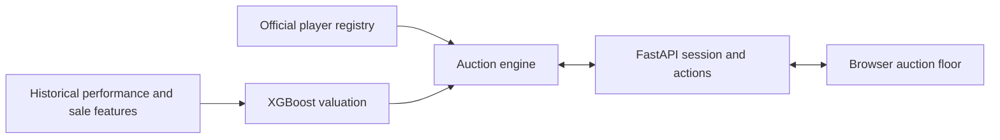

# IPL Auction Room

**Run an IPL franchise from the auction table.**

Pick your team, set your retentions, and raise your paddle against nine AI franchises in a browser recreation of the **2025 IPL mega auction**. Decide when to chase a marquee player, when to let a rival spend, and how much purse to save for the uncapped sets.

[Quick start](#quick-start) · [Auction room features](#auction-room-features) · [Sports ML benchmark](#sports-ml-benchmark) · [Architecture](#architecture) · [Contribute](#contribute)

| Franchises | Player registrations | Auction set groups | Historical training sales | Replay price MAE |
| :---: | :---: | :---: | :---: | :---: |
| **10** | **577** | **79** | **929** | **₹1.86 Cr** |

The registration count comes from the revised auction list with player-specific Right to Match eligibility. The price error comes from the set-held-out 2025 replay benchmark below. [Revised IPL auction list](https://documents.iplt20.com/bcci/documents/1732248356511_TATA%20IPL%202025-%20Auction%20List%20with%20RTM%20-19.11.24.pdf)

## Auction room features

| Feature | What you can do |
| --- | --- |
| **Live auction floor** | Bid directly from your franchise's table. See delegates raise paddles, bids arrive one at a time, and the auctioneer call the lot. |
| **Franchise management** | Choose your retentions, track official opening purse deductions, and decide whether to match a final RTM bid. |
| **Player scouting** | Compare reserve, sale probability, price range if sold, and available pre-auction form. |
| **Rival squad inspection** | Open any rival table to see its purse, squad, and projected XI vacancies. |
| **Set-by-set play** | Reveal opening sets, nominate players for accelerated rounds, or use **Skip player** to finish a lot and move on. |
| **Auction record** | Review live bid history and completed results, including winning franchises, sale prices, and unsold players. |

The **3D room** opens automatically during bidding. Use **Wide camera** to see all ten tables, **Back to my seat** to return, and **Table view** for a lighter layout. Every confirmed sale displays the player and price in the winning team's colors. After the final lot, the **Playing XI** editor starts from a suggested lineup and lets you swap players, reorder the batting lineup, and choose a wicketkeeper.

The AI uses franchise preferences, positional needs, available alternatives, and money per open squad slot to decide whether to bid and where to stop. Teams earmark part of their opening purse for accelerated rounds. A lot can go unsold while teams still have cash and roster space.

## Quick start

Use Python 3.10 or newer from the repository root.

```bash
python -m pip install -r requirements.txt
python main.py
```

Open [http://127.0.0.1:8000](http://127.0.0.1:8000), choose your franchise, and select **Open bidding** after the first set reveal. The browser resumes your session on refresh while the server is running.

Use `python main.py --port 8001` if port 8000 is occupied, or `python -m src.auction_simulator` for terminal play.

## Sports ML benchmark

Two models serve different purposes. The original 17-feature model remains available on 171 matched registrations and retains its pre-2025 training cutoff. The **2025 replay model** covers all 577 registrations with separate XGBoost models for sale probability and conditional price quantiles. It uses the reserve, roster metadata, prior observed sale price, and pre-auction form when available.

### Rebuilt 2025 replay data

The pipeline reconciles all 182 sales to ₹639.15 Cr and joins 313 registrations to unique Cricsheet IDs. It recovers pre-auction form for 181 registrations from 760 men's T20 fixtures and uses metadata for players without mapped deliveries. Each prediction comes from a fold that withheld that player's set. This is a retrospective replay using other 2025 sets, so it measures same-event generalization. The probability is of a registration ending up sold, which includes the chance of being nominated and called.

The updated model predicts the premium above reserve, uses the published set order, and blends price quantiles with comparable sales from the training sets.

| Set-held-out metric | Previous replay model | Updated replay model |
| --- | ---: | ---: |
| Sale probability Brier score | 0.160 | **0.140** |
| Median-price MAE across 182 sales | ₹2.34 Cr | **₹1.86 Cr** |
| Median-price MAE on the 30 sales of ₹8 Cr or more | ₹9.31 Cr | **₹5.65 Cr** |
| P20–P80 interval coverage for premium sales | 20% | **50%** |

The P20–P80 interval covered 64.3% of all sold players. The set-held-out results were used to compare model designs. Validate the chosen model on a separate auction to measure forecasting accuracy.

```bash
python -m src.rebuild_pool --people people.csv --names names.csv ipl_json.zip t20s_male_json.zip bbl_json.zip psl_json.zip cpl_json.zip sma_json.zip sat_json.zip
python -m src.benchmark_auction --seeds 30 --seed-start 20
python -m unittest discover -s tests
```

The generated estimates and retained-player form ship with the app. To rebuild them, download the archives and alias register from Cricsheet. Phase features use powerplay overs 1–6, middle overs 7–15, and death overs 16–20.

The derived form tables use Cricsheet match data and the Cricsheet Register, both made available under the Open Data Commons Attribution License (ODC-By) v1.0. [Match downloads](https://cricsheet.org/downloads/) · [Cricsheet Register](https://cricsheet.org/register/) · [ODC-By v1.0](https://opendatacommons.org/licenses/by/1-0/)

### Historical valuation accuracy

The original model's rolling backtest evaluated **527 sales** in the 2018, 2019, 2020, 2021, and 2022 auctions. Each fold used earlier seasons for training. The saved model configuration reduced pooled mean absolute error by about **14%** compared with the training-median baseline. The original weights were trained on pre-2025 sales.

| Model or experiment | All sales MAE | Sales of ₹8 Cr or more MAE |
| --- | ---: | ---: |
| Training-median baseline | ₹2.16 Cr | — |
| **Original XGBoost configuration** | **₹1.85 Cr** | **₹7.53 Cr** |
| 350 trees at depth 4 | ₹1.85 Cr | ₹7.46 Cr |
| Current settings with 3× weight on sales of ₹8 Cr or more | ₹1.86 Cr | ₹7.18 Cr |
| Squared error on crore prices | ₹1.95 Cr | ₹6.65 Cr |

All 46 premium sales in these folds were underpredicted by the current model. The experiments use the same historical folds and are exploratory. An untouched auction is the next test for any candidate.

<details>
<summary>Model settings, retraining, and data coverage</summary>

- **Target and loss** — `log1p(sold_price_crore)` with squared error. Inference converts estimates back to crore.
- **Training rows** — 929 pre-2025 sales after filtering nonpositive prices and ambiguous player-year duplicates.
- **Parameters** — 200 trees, depth 3, learning rate 0.04, minimum child weight 5, 85% row and column subsampling, and seed 42.
- **Reproduction** — Run `python -m src.train_predictor` to evaluate the latest historical holdout, refit, and write `models/auction_price.ubj`. The 2022 fold contains 195 sales and scored ₹2.04 Cr MAE. The table above comes from the separate five-fold audit.
- **Data limits** — The checkout includes the processed feature matrix. Rebuilding features requires raw delivery and historical auction files absent from this checkout. The committed 2025 features still need a raw-data cutoff audit.

</details>

### Simulator versus the real auction

| Measure | Simulator, mean of 30 all-AI runs | Actual 2025 auction |
| --- | ---: | ---: |
| Signings | 181.3 | 182 |
| Overseas signings | 63.9 | 62 |
| Auction spend | ₹618.02 Cr | ₹639.15 Cr |
| Highest signing | ₹27.73 Cr | ₹27 Cr |
| Marquee group spend | ₹211.42 Cr | ₹180.50 Cr |

These runs used seeds 20–49, separate from the calibration seeds, with the same 2025 player pool and outcomes as the benchmark. They averaged 106 accelerated-round signings, with 17.4% of called players finishing unsigned and 0.55 specialist XI vacancies per team. Mean absolute squad-size error was 2.32 players per franchise and mean absolute remaining-purse error was ₹2.13 Cr. Aggregate realism improved, but some individual sets still miss substantially. For example, FA2 averaged ₹2.91 Cr versus ₹46.90 Cr in actual spending. The tuning values are 2025 replay defaults. [Official IPL auction results](https://www.iplt20.com/auction/2025/teams) · [Franchise purse and squad totals](https://www.cricbuzz.com/cricket-series/ipl-2025/auction/teams)

## Architecture



| Layer | Implementation |
| --- | --- |
| **Interactive browser UI** | [Three.js auction room](web/auction-room.js) with original animated geometry and [HTML controls](web/index.html) for bidding, scouting, and editing the Playing XI. |
| **Auction session API** | [FastAPI](src/web_app.py) exposes configuration, session start, current state, and auction actions. |
| **Simulation engine** | [Python auction state machine](src/simulator_engine.py) handles bidding, team eligibility, purses, lot settlement, and set transitions. |
| **Playing XI selection** | [Roster strategy](src/team_strategy.py) uses sample-adjusted phase form and selects a lineup under a shared four-overseas limit. The selector fills specialist gaps first and then maximizes form. |
| **Valuation pipeline** | [2025 replay modeling](src/rebuild_pool.py), [generated replay estimates](data/processed/pool_estimates_2025.csv), and the [original XGBoost model](models/auction_price.ubj). |

## Contribute

Cricket analysts, sports ML practitioners, and frontend contributors can take on a measurable problem:

| Area | A useful contribution |
| --- | --- |
| **Cricket data** | Improve identity coverage and add past complete registration pools for temporal validation. |
| **Market modeling** | Validate sale probabilities and conditional ranges on a separate auction. Track errors by role, reserve tier, and capped status. |
| **Auction fidelity** | Calibrate accelerated nomination sizes and spend by set. The engine includes the 2025 RTM counteroffer flow and uses simplified tie handling. |
| **Franchise strategy** | Improve the six role assignments and benchmark XI coverage, overseas slots, and spend curves against real squads. |
| **Frontend** | Improve keyboard bidding, compare rival squads at a glance, or visualize how a team's purse changes over the session. |

A contribution is easiest to review when it includes a concrete auction scenario, a reproducible backtest, or a before-and-after comparison.

### Data references

- [Revised auction registry with player-specific Right to Match eligibility](https://documents.iplt20.com/bcci/documents/1732248356511_TATA%20IPL%202025-%20Auction%20List%20with%20RTM%20-19.11.24.pdf)
- [Official 2025 retention and purse allocations](https://www.iplt20.com/news/article/ipl-2025-player-retentions-list-announced)
- [IPL 2025–27 player regulations](https://www.iplt20.com/news/article/ipl-governing-council-announces-tata-ipl-player-regulations-2025-27)
