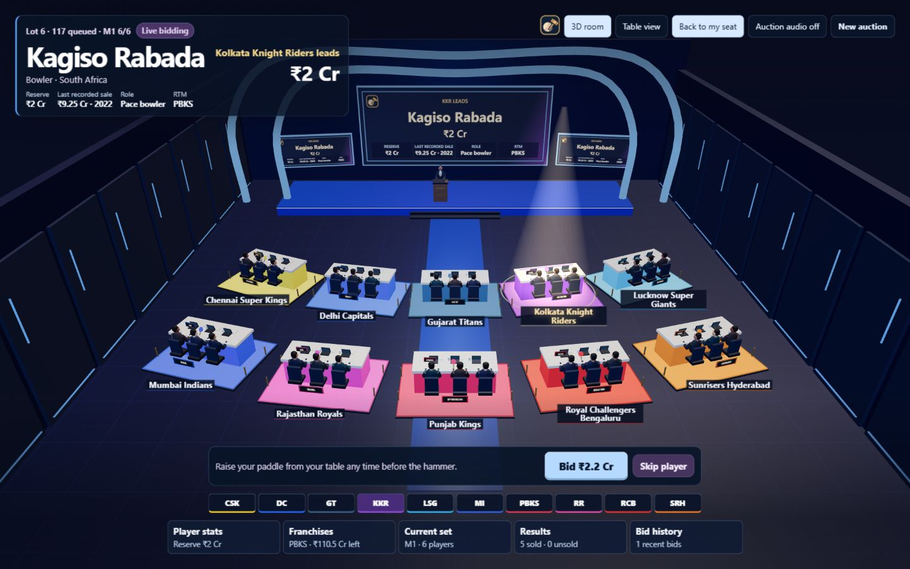
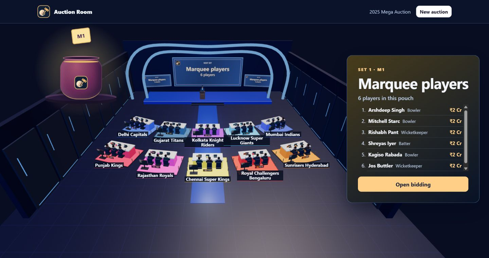
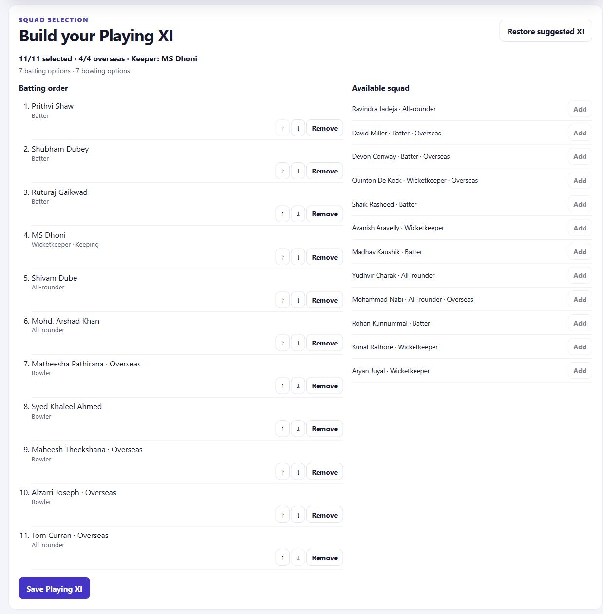
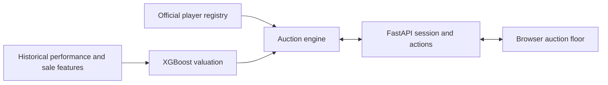

# IPL Auction Room

**Build an IPL squad from the auction table.**

Run one of ten franchises in a browser replay of the **2025 IPL mega auction**. Set your retentions, bid against nine squad-aware AI franchises, and pick your Playing XI after the final hammer. The same player pool powers a reproducible sports ML benchmark for sale probability, price uncertainty, and franchise strategy.

[Quick start](#quick-start) · [Inside the game](#inside-the-game) · [Sports ML benchmark](#sports-ml-benchmark) · [Simulator benchmarks](#simulator-versus-the-real-auction) · [Architecture](#architecture)

| Franchises | Registered player pool | Published set groups | Historical training sales | Replay price MAE |
| :---: | :---: | :---: | :---: | :---: |
| **10** | **577** | **79** | **929** | **₹1.86 Cr** |



*The wide camera during a live lot. The overhead spotlight follows the highest bidder.*

## Inside the game

| Feature | How it plays |
| --- | --- |
| **Franchise setup** | Pick a team and choose whom to retain. Retention deductions and the ₹120 Cr salary cap determine your opening purse. |
| **Live 3D bidding** | Raise your paddle from the arena, switch between the wide camera and your seat, or use the lighter table view. The auctioneer gestures through the calls and strikes the gavel on a sale. Spoken calls and the hammer sound are optional. |
| **Player and rival scouting** | The live board shows the reserve, last recorded sale and season when available, playing role, and applicable RTM. Open Player Stats for valuation, sale probability, conditional price range, and available form. Inspect rival purses, squads, and projected XI vacancies in the room. |
| **Set reveals and shuffled lots** | Watch the pouch open inside the wide-camera arena. The roster card shows the category, order, and reserve prices. Players shuffle within each set while the published opening-set order stays intact. |
| **Your pace between lots** | **Skip player** resolves the current lot and shows the result. Bidding remains paused until you select **Ready for next player**, including after a refresh. |
| **Accelerated bidding and final recall** | Submit a searchable, role-filtered sheet of up to ten players. AI franchises submit their own shortlists based on squad fit and affordability. Shared nominations produce a single lot, and both accelerated stages use shorter bidding intervals. |
| **Right to Match** | An eligible former franchise can request RTM, the winning bidder can make a final offer, and the eligible franchise can match that final price. Eligibility and remaining slots are tracked per franchise. |
| **Sale ceremony and results** | A full-screen, team-colored SOLD reveal shows the winning franchise, player, and price. Review recent bids and sold or unsold outcomes from the arena. |
| **Playing XI** | Start from a suggested XI, swap in players from your squad, reorder the batting lineup, and choose a wicketkeeper. The editor enforces the four-overseas limit. |



*The next set appears beside the arena. Select Open bidding when you are ready.*

### How the auction moves

1. **Opening sets.** Players are offered in shuffled order within each set. Teams can pass even when they have room and money.
2. **First accelerated round.** After opening sets 1–17, submit a sheet of up to ten uncalled players from the later sets. Search by name or filter by role and check each player's reserve price before submitting. The AI franchises build their own sheets using affordability, overseas slots, and squad needs. The engine merges all submitted names and offers each nominated player once.
3. **Final recall.** Submit a fresh sheet with players who went unsold in either stage or were never called. The sheet marks previously unsold players so you can distinguish them from first-time lots. AI franchises nominate again using their updated squads and purses. Players already sold are excluded.
4. **Playing XI.** Review the final squads and build your match lineup from the players you signed.

The catalog count describes registrations. The live counter shows the current lot, the number queued so far, and the position within the set. Nomination rounds add lots to the queue, and a recalled player can appear twice. The nomination cap and exact bidding intervals are simulator settings. [Revised IPL auction list](https://documents.iplt20.com/bcci/documents/1732248356511_TATA%20IPL%202025-%20Auction%20List%20with%20RTM%20-19.11.24.pdf) · [BCCI accelerated procedure as reported by Cricbuzz](https://www.cricbuzz.com/cricket-news/132439/auction-register-churned-as-accelerated-process-to-begin-from-player-no117-cricbuzzcom)

In both accelerated rounds, the opening window drops from **2.4 s to 1.35 s**, the wait after a bid drops from **1.45–2.25 s to 0.75–1.20 s**, and the wait after each closing call drops from **2.6 s to 1.25 s**. After the result, the next lot still waits for your confirmation.

### Build your Playing XI

Start with the suggested XI, swap players in from the available squad, set the batting order, and select a wicketkeeper. The editor shows the overseas count and the number of batting and bowling options. A saved lineup must have eleven distinct players, a wicketkeeper, and at most four overseas players.



*Playing XI editor after a sample Chennai Super Kings auction.*

## Quick start

Use Python 3.10 or newer from the repository root.

```bash
python -m pip install -r requirements.txt
python main.py
```

Open [http://127.0.0.1:8000](http://127.0.0.1:8000), choose your franchise, and select **Open bidding** after the first set reveal. The browser resumes your session on refresh while the server is running.

Use `python main.py --port 8001` if port 8000 is occupied, or `python -m src.auction_simulator` for terminal play.

## Sports ML benchmark

Two models serve different purposes. The original 17-feature model remains available on 171 matched registrations and retains its pre-2025 training cutoff. The **2025 replay model** covers all 577 registrations with separate XGBoost models for sale probability and conditional price quantiles. It uses the reserve, roster metadata, prior observed sale price, and pre-auction form when available.

### Rebuilt 2025 replay data

The pipeline reconciles all 182 sales to ₹639.15 Cr and joins 313 registrations to unique Cricsheet IDs. It recovers pre-auction form for 181 registrations from 760 men's T20 fixtures and uses metadata for players without mapped deliveries. Each prediction comes from a fold that withheld that player's set. This is a retrospective replay using other 2025 sets, so it measures same-event generalization. The probability is of a registration ending up sold, which includes the chance of being nominated and called.

The updated model predicts the premium above reserve, uses the published set order, and blends price quantiles with comparable sales from the training sets.

| Set-held-out metric | Previous replay model | Updated replay model |
| --- | ---: | ---: |
| Sale probability Brier score | 0.160 | **0.140** |
| Median-price MAE across 182 sales | ₹2.34 Cr | **₹1.86 Cr** |
| Median-price MAE on the 30 sales of ₹8 Cr or more | ₹9.31 Cr | **₹5.65 Cr** |
| P20–P80 interval coverage for premium sales | 20% | **50%** |

The P20–P80 interval covered 64.3% of all sold players. The set-held-out results were used to compare model designs. Validate the chosen model on a separate auction to measure forecasting accuracy.

```bash
python -m src.rebuild_pool --people people.csv --names names.csv ipl_json.zip t20s_male_json.zip bbl_json.zip psl_json.zip cpl_json.zip sma_json.zip sat_json.zip
python -m src.benchmark_auction --seeds 30 --seed-start 0
python -m unittest discover -s tests
```

The generated estimates and retained-player form ship with the app. To rebuild them, download the archives and alias register from Cricsheet. Phase features use powerplay overs 1–6, middle overs 7–15, and death overs 16–20.

The derived form tables use Cricsheet match data and the Cricsheet Register, both made available under the Open Data Commons Attribution License (ODC-By) v1.0. [Match downloads](https://cricsheet.org/downloads/) · [Cricsheet Register](https://cricsheet.org/register/) · [ODC-By v1.0](https://opendatacommons.org/licenses/by/1-0/)

### Historical valuation accuracy

The original model's rolling backtest evaluated **527 sales** in the 2018, 2019, 2020, 2021, and 2022 auctions. Each fold used earlier seasons for training. The saved model configuration reduced pooled mean absolute error by about **14%** compared with the training-median baseline. The original weights were trained on pre-2025 sales.

| Model or experiment | All sales MAE | Sales of ₹8 Cr or more MAE |
| --- | ---: | ---: |
| Training-median baseline | ₹2.16 Cr | — |
| **Original XGBoost configuration** | **₹1.85 Cr** | **₹7.53 Cr** |
| 350 trees at depth 4 | ₹1.85 Cr | ₹7.46 Cr |
| Current settings with 3× weight on sales of ₹8 Cr or more | ₹1.86 Cr | ₹7.18 Cr |
| Squared error on crore prices | ₹1.95 Cr | ₹6.65 Cr |

All 46 premium sales in these folds were underpredicted by the current model. The experiments use the same historical folds and are exploratory. An untouched auction is the next test for any candidate.

<details>
<summary>Model settings, retraining, and data coverage</summary>

- **Target and loss** — `log1p(sold_price_crore)` with squared error. Inference converts estimates back to crore.
- **Training rows** — 929 pre-2025 sales after filtering nonpositive prices and ambiguous player-year duplicates.
- **Parameters** — 200 trees, depth 3, learning rate 0.04, minimum child weight 5, 85% row and column subsampling, and seed 42.
- **Reproduction** — Run `python -m src.train_predictor` to evaluate the latest historical holdout, refit, and write `models/auction_price.ubj`. The 2022 fold contains 195 sales and scored ₹2.04 Cr MAE. The table above comes from the separate five-fold audit.
- **Data limits** — The checkout includes the processed feature matrix. Rebuilding features requires raw delivery and historical auction files absent from this checkout. The committed 2025 features still need a raw-data cutoff audit.

</details>

### Simulator versus the real auction

| Measure | Simulator, 30 seeded all-AI runs | Actual 2025 auction |
| --- | ---: | ---: |
| Signings | 186.40 | 182 |
| Overseas signings | 67.97 | 62 |
| Auction spend | ₹631.91 Cr | ₹639.15 Cr |
| Highest signing | ₹29.16 Cr | ₹27.00 Cr |
| Marquee spend | ₹213.99 Cr | ₹180.50 Cr |

| Additional replay diagnostics | Mean |
| --- | ---: |
| Accelerated-round signings | 110.93 |
| Called players who finished unsigned | 19.43% |
| Full pool unsigned | 67.69% |
| Specialist XI roles unfilled per team | 0.47 |
| Final squad-size MAE per franchise | 2.04 players |
| Remaining purse MAE per franchise | ₹0.89 Cr |

These runs use seeds 0–29 with the two-stage nomination engine and fixed 2025 pool. The AI weighs squad needs, alternative players, franchise preferences, and slot-level budgets. Aggregate spend is close to the recorded auction, while the simulator overstates marquee spend and overseas signings. This benchmark measures the simulation's behavior on the replay pool. The separate model tables above measure prediction error. [Official IPL auction results](https://www.iplt20.com/auction/2025/teams) · [Franchise purse and squad totals](https://www.cricbuzz.com/cricket-series/ipl-2025/auction/teams)

## Architecture



| Layer | Implementation |
| --- | --- |
| **Interactive browser UI** | [Three.js auction room](web/auction-room.js) with original animated geometry and [HTML controls](web/index.html) for bidding, scouting, and editing the Playing XI. |
| **Auction session API** | [FastAPI](src/web_app.py) exposes configuration, session start, current state, and auction actions. |
| **Simulation engine** | [Python auction state machine](src/simulator_engine.py) handles bidding, team eligibility, purses, lot settlement, and set transitions. |
| **Playing XI selection** | [Roster strategy](src/team_strategy.py) uses sample-adjusted phase form and selects a lineup under a shared four-overseas limit. The selector fills specialist gaps first and then maximizes form. |
| **Valuation pipeline** | [2025 replay modeling](src/rebuild_pool.py), [generated replay estimates](data/processed/pool_estimates_2025.csv), and the [original XGBoost model](models/auction_price.ubj). |

## Contribute

Cricket analysts, sports ML practitioners, and frontend contributors can take on a measurable problem:

| Area | A useful contribution |
| --- | --- |
| **Cricket data** | Improve identity coverage and add past complete registration pools for temporal validation. |
| **Market modeling** | Validate sale probabilities and conditional ranges on a separate auction. Track errors by role, reserve tier, and capped status. |
| **Auction fidelity** | Calibrate accelerated nomination sizes and spend by set. The engine includes the 2025 RTM counteroffer flow and uses simplified tie handling. |
| **Franchise strategy** | Improve the six role assignments and benchmark XI coverage, overseas slots, and spend curves against real squads. |
| **Frontend** | Improve keyboard bidding, compare rival squads at a glance, or visualize how a team's purse changes over the session. |

A contribution is easiest to review when it includes a concrete auction scenario, a reproducible backtest, or a before-and-after comparison.

### Data references

- [Revised auction registry with player-specific Right to Match eligibility](https://documents.iplt20.com/bcci/documents/1732248356511_TATA%20IPL%202025-%20Auction%20List%20with%20RTM%20-19.11.24.pdf)
- [Official 2025 retention and purse allocations](https://www.iplt20.com/news/article/ipl-2025-player-retentions-list-announced)
- [IPL 2025–27 player regulations](https://www.iplt20.com/news/article/ipl-governing-council-announces-tata-ipl-player-regulations-2025-27)

The simulator is an independent fan project unaffiliated with the IPL, BCCI, or its franchises. The screenshots show the local browser build.
